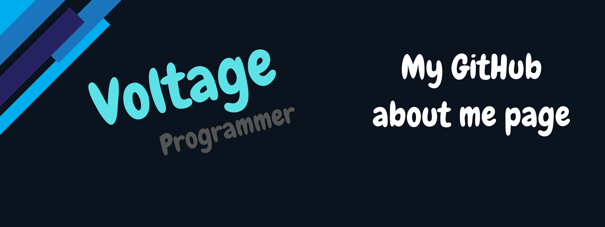

<!-- Banner -->

<!-- Title -->
# Hello World! - Voltage

<!-- Badges -->

<!-- Description -->
Hi, I go by **Voltage** online, but most people call me **Volt** (*or even "Blueberry"*). I’m a small full stack developer with a growing interest in cybersecurity and offensive security. I spend most of my time experimenting with coding projects, creating music, and exploring the Linux ecosystem.

## About Me
- Full stack developer
- Music Producer
- Content Creator
- Casual Gamer
- Linux enthusiast

I enjoy playing skill based or classical games, Roblox, Minecraft, Tetris, Minesweeper and other challenges that let me flex strategy and knowledge.

## Skills & Interests
- **Programming:** Rust, Python, Lua (Including Roblox Luau), HTML, CSS, JavaScript, SQL, Markdown, Batch, Bash/Zsh
- **Platforms:** Linux (Arch), Tracktion Waveform, Davinci Resolve, Roblox Studio
- **Cybersecurity:** Red Teaming, Hack The Box, Hacker One, Try Hack Me, Hack This Site
- **Music & Content:** Producing Hyperpop, Digicore, Pop Punk, Emo Rock, and Metalcore beats, playing guitar, making videos

I get obsessed with ideas quickly, and while I don’t always have time to see every passion through, I like to explore and experiment constantly.

## Lifestyle & Philosophy
- Highly terminal centric; I embrace FOSS and minimal setups
- Critical thinker with a tendency to dive deep into projects
- Enjoy sharing knowledge and helping others learn, if they listen

Some people find my personality unusual or abrasive, but if you respect curiosity and competence, you’ll be fine.

<!-- GitHub Stats -->
## GitHub Stats

<!-- Socials -->
## Contact Me
### General/Dev & Tech
- Email: [voltage.gateway@gmail.com](mailto:voltage.gateway@gmail.com)
- GitHub: [voltage-86](https://github.com/voltage-86)
- Discord: [voltage86](https://discord.com/users/voltage86)
- IRC Libera Chat: voltage86!~user@libera/user/voltage86
- Matrix: @voltage86:matrix.org
### Media
- YouTube
  - Main / Tech: [@devbyvolt](https://www.youtube.com/channel/UC5E5z54o4bWmvuid1By9wvA)
  - Gaming: [@voltage86](https://www.youtube.com/channel/UCrESlHE_FPNAe4HlF_0VYdQ)
  - Music: [@prodbyvolt86](https://www.youtube.com/channel/UC2KutyzrejkLWqGWr8_es6w)
- Instagram: [prodbyvolt](https://www.instagram.com/prodbyvolt)
- Twitch: [prodbyvolt](https://www.twitch.tv/prodbyvolt)
- Reddit: [voltage-86](https://reddit.com/u/voltage-86)
### Gaming
- Steam: [voltage86](https://steamcommunity.com/profiles/76561199840312199)
- Roblox: [889985406612](https://roblox.com/users/309843262/profile)
- Tetrio: [VOLTAGE86](https://ch.tetr.io/u/voltage86)
- Minecraft
  - Java: voltage86
  - Bedrock: prodbyvolt
